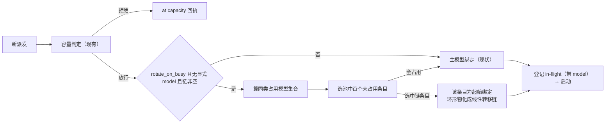

# 设计：fallback_models 同类并发轮换

## 1. 现状事实（已核对源码）

- 绑定解析：`resolveSubagentDefaults`（core `domain/config.js`）产出 `effective.{model, effort, fallbackModels, maxConcurrent, tools}`，字段级分层合并（profile 优先、legacy 回退），来源记 `configSources`。
- 失败转移：`fallback_models` 只在模型不可访问错误（core `domain/failover.js` 白名单 code）时被读取。派发时同步走链（`executor-failover.ts` 的 `startDispatchWithFailover`）与结算后异步重派（`runAsyncFailover`）共用 `runFallbackChain`（`executor-failover-chain.ts`）——按 `startIndex` 线性走到链尾，穷尽抛 `FallbackChainExhaustedError`。
- 并发上限判定：`collectRunningExecutors`（adapter `executor-capacity.ts`）取 `listDescendants` 直子级 running 行，kind 由本任务 `dispatches` 记录或 label 反查补齐，合并进程内 in-flight 集（只带 kind）；判定委托 core `domain/executor-capacity.js` 的 `evaluateExecutorCapacity`，记录形如 `{childId, kind}`，不带模型。
- 派发留痕：`recordExecutorDispatch`（core `domain/task-store.js`）校验 `modelSource` 必须在 `DISPATCH_MODEL_SOURCE_SET` 值域内（现为 param/whenMain/fallback/legacy/inherit/spawn）。
- `PARENT_MODEL_LABEL = '<parent session>'` 现定义在 adapter `executor-failover-chain.ts`，回执与转移文案共用该口径。
- adapter-pi 不读 `fallback_models`，本改动不涉及。

## 2. 总体方案

新增配置开关 `rotate_on_busy`（与 `fallback_models` 同层，默认 false）。开启且未显式传 `model` 时，新派发把 `[主模型位, fb1..fbN]` 看作轮换池：

1. 从运行集合同步算出「同 kind 已占用模型」集合；
2. 取池中第一个未被占用的条目作为本次派发的起始绑定（全占用回绕主模型位）；
3. 失败转移沿用现有线性走链机制——把环形顺序在派发时刻**物化成线性链**传入，`runFallbackChain` / `FailoverContext` / 结算重派零改动或最小改动。

## 3. 环形物化（关键决策）

池 `pool = [P, F1..FN]`，P 为主模型位：`effective.model` 显式时为该模型；继承形态（无显式主模型）时为 `PARENT_MODEL_LABEL`。轮换选中起点 `pool[i]`：

- `i = 0`：物化即现状——起始绑定 P，转移链 `[F1..FN]`，零行为变化。
- `i > 0`：起始绑定 `F_i`，转移链物化为环的剩余部分 `[F_{i+1}..F_N, P, F_1..F_{i-1}]`。
- P 条目物化：`effective.model` 显式时进链为 `{model: effective.model, effort: effective.effort}`；继承形态时进链为 `{model: PARENT_MODEL_LABEL}`，`buildFallbackAgentOptions` 对该 label 特判——不携带 provider/model（保持继承父会话），仅携带条目 effort（如有）。这是走链模块唯一新增特判分支。
- `attempt` 语义不变：起始跳 = 1，物化链第 k 条 = k+1；`FailoverContext.primaryModel` 存**起点模型**（穷尽消息链起点），`chain` 存物化后的线性数组——结算后异步重派按 `attempt - 1` 的 `startIndex` 继续走物化链，逻辑零改动。
- 穷尽消息与穷尽通知的尝试链 = 起点模型 + 物化链按序，即实际环形顺序。

否决备选：给 `runFallbackChain` 加 wrap 参数（循环取模）——两条触发路径的 attempt/startIndex 语义都要跟着改，物化方案把环形收敛在派发时刻一次计算，机制面更小。

## 4. 占用集合与选取纯函数（core 新 domain 模块）

新增 `packages/core/src/domain/executor-rotation.js`（+ 手写 `.d.ts` 锚点，纯 JS + JSDoc，无 IO）：

- `selectRotationStartIndex({ poolModels, usedModels }) → number`：按池顺序返回首个不在 `usedModels` 的下标；全占用返回 0（回绕主模型位）。入参均为模型 label 字符串数组，纯同步。
- `materializeRingChain({ pool, startIndex }) → { startEntry, chain }`：按 §3 规则产出起始条目与线性化转移链。`pool` 条目形如 `{model, effort?}`。

`PARENT_MODEL_LABEL` 单一来源上移到 core `domain/dispatch-binding.js`（绑定展示口径归属该模块），adapter `executor-failover-chain.ts` 改为从 core 导入并 re-export（现有 `executor-failover.ts` → `executor.ts` 的转出口径不变）。

## 5. 占用模型的取数（adapter `executor-capacity.ts`）

三级优先，读不到按占用主模型位处理（保守，宁多占主模型位也不误判空闲）：

1. **进程内绑定登记**：新增 `Map<childId, {kind, model}>`——派发成功（含转移跳、异步重派）时写入，结算消费时删除；插件重启丢失。
2. **本任务 `dispatches` 记录**：`collectRunningExecutors` 现成的 kind 补全路径同步补 `model`（记录里有 `model` 字段；无 model 的旧记录视为读不到）。
3. **读不到**：该 child 的占用按主模型位 label 计（由调用方归一，core 纯函数不感知）。

配套改动：

- core `RunningExecutorRecord` 增加可选 `model?: string`（`evaluateExecutorCapacity` 不读该字段，容量语义零变化）。
- in-flight 条目增加 `model` 字段：`registerInFlightDispatch(seq, kind, model)`，`getInFlightDispatches` 透出——同轮并行两笔派发时，第二笔在同步段能看到第一笔的已选模型，不撞同一模型。

## 6. 派发编排（adapter `executor.ts` 新派发分支）

时序（遵守 code-style concurrency：判定与登记之间无 await 间隙）：

1. `runCapacityGate` 改为一次取数两用：返回 `{ text, running }`（容量判定用 `text`，轮换选取用 `running`），避免二次 `listDescendants` 的异步窗口。
2. 容量放行后的**同步段**内：若 `rotateOnBusy && params.model === undefined && fallbackModels.length > 0`，算 `usedModels`（running 中同 kind 条目的 model，缺失归一为主模型位 label；kind 为空的未知 child 不算同类），调 `selectRotationStartIndex`；选中链条目（i>0）时：`agentOptions = buildFallbackAgentOptions(startEntry)`，`failoverChain = 物化链`，`primaryModel = startEntry.model`，并产出 `rotation = { model, effort? }` 标注。
3. `registerInFlightDispatch(seq, kind, 本次实际选定 model label)`——开关关闭或未轮换时记主模型位 label。
4. 留痕：轮换起始跳 `dispatches` 记 `model/effort`（实际选定值）+ `modelSource: 'rotate'`；转移跳照旧 `fallback` + `fallbackOf` 链式关联。`registerFailoverContext` 的 `chain/attempt/currentModel/primaryModel` 按物化链与起点填写。
5. 回执：`TurnMeta` 增加 `rotation?: { model }`，渲染 `(rotated: <model>)` 标注；同次派发又发生转移时，现有 `(failover attempt N: <model>)` 照常叠加，最终以实际生效模型为准。

不轮换的场景（零变化路径）：开关未开、显式 `model`（转移链同样不启用，现状）、续用轮（绑定首次派发定死）、容量拒绝（先判容量再选模型）。

## 7. 配置层（core `domain/config.js` + `config.d.ts`）

- `parseSubagentSpec` 允许字段清单加 `rotate_on_busy`：值必须为 boolean，非法按字段路径 fail loud（`...rotate_on_busy must be a boolean`）；仅 true 时落内存字段 `rotateOnBusy`（false/缺省不落，同 `fallbackModels` 模式）。两层（legacy `subagents` 与 `subagent_profiles[].subagents`）同语法。
- `resolveSubagentDefaults` 字段级合并：profile 命中层优先、legacy 回退，`configSources.rotateOnBusy` 记来源（与 `fallbackModels` 合并模式一致）。
- 不做「开关开启但链为空」的交叉校验：分层合并后链可能来自另一层，交叉校验复杂且收益低；链为空时轮换天然不生效（§6 条件），无静默错误。

## 8. 值域与文案

- core `domain/task-store.js`：`DISPATCH_MODEL_SOURCES` 增加 `ROTATE: 'rotate'`（校验集合由常量派生，自动放行）；`DispatchModelSource` 类型联合加 `'rotate'`。旧任务记录不受影响（值域只增不减）。
- core `surface.ts`：executor 工具 description 追加一句英文轮换语义（与 failover 句并列）：`with rotate_on_busy enabled, dispatching a kind that already has a running session starts on the next unused model of the fallback pool`。
- 回执标注 `(rotated: <model>)` 为英文 runtime 文案，渲染在 adapter `executor-receipt.ts`/`executor-continuation.ts` 现有 receipt 行内。

## 9. 边界路径

| 场景 | 行为 |
| --- | --- |
| 开关关（默认） | 全链路与现状逐字节一致（回归用例保护） |
| 开关开、无同类在跑 | 用主模型位，无 rotated 标注 |
| 同类在跑但绑定三级都读不到 | 按占用主模型位处理 |
| 池全占用 | 回绕主模型位，照常派发（不拒绝、不排队） |
| 同轮并行两笔同类派发 | in-flight 条目带 model，第二笔同步段可见第一笔选择 |
| 轮换起点不可访问（派发时同步） | 按物化链走（即环形顺序），穷尽报完整环链 |
| 轮换起点运行中失败（结算后） | `runAsyncFailover` 沿物化链续走，通知与留痕口径不变 |
| 继承主模型位绕回 | `PARENT_MODEL_LABEL` 条目特判：不携带 model，仅 effort |
| 显式 model / 续用轮 | 不轮换、不物化（现状语义） |
| 插件重启后同类仍在跑 | 进程内登记丢失 → dispatches 记录回退 → 读不到按主模型位 |
| `max_concurrent` 语义 | 不变：轮换只改选模型，不改槽位计数 |

## 10. 测试设计（与实现同批交付）

- core `config.test.js`：两层合法解析、非布尔 fail loud（字段路径）、分层合并（profile 优先/legacy 回退/未配置不落字段）。
- core 新 `executor-rotation.test.js`：`selectRotationStartIndex`（无占用/主模型位占用/多占用/全占用回绕/未知不计）；`materializeRingChain`（i=0 恒等、i 中段回绕、显式 P 与继承 P 物化）。
- core `task-store` 相关测试：`modelSource: 'rotate'` 放行、非法值仍拒。
- adapter `executor.test.js`：§9 边界表逐行覆盖（开关关零变化、轮换选取与回执/留痕、in-flight 并行不撞、环形转移与穷尽文案、显式 model、续用轮、绑定读不到归一）。

## 11. 部署

core 与 adapter-dsh 的 `dist/` 与 src 同 commit 重建提交（`pnpm -r build`）；生效需用户授权重启实例，agent 不自行重启。
