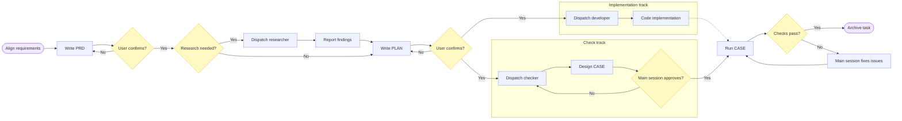

# workloom

workloom is a working method that has AI deliver requirements through a fixed process. It turns one requirement into clear role responsibilities and a traceable record.

[中文](./README.md)

## Contents

- [Quick start](#quick-start)
- [What workloom is](#what-workloom-is)
- [Role design](#role-design)
- [Role collaboration](#role-collaboration)
- [Workflow](#workflow)
- [Configuration](#configuration)
- [Skills you can invoke](#skills-you-can-invoke)

## Quick start

### Prerequisites

workloom runs as a plugin inside DeepSeek Harness. Before you start, confirm it is installed.

### Initialize a project

Run `workloom init` in the project session. It creates or updates the `.workloom/` directory, which holds tasks, standards, and session records.

Then run `workloom-doctor` for a health check. It verifies configuration and injection.

### Walk through your first task

1. Describe what you want in the session. Be as specific as you can.
2. The main session decides whether it warrants a task and recommends. The task is created only after you confirm.
3. Requirements alignment begins. The main session asks in rounds along a design tree, listing all open questions each round. You answer them.
4. Once no grey area remains, the main session presents the PRD for your confirmation. This is the first confirmation.
5. When research is needed, the researcher writes findings to files.
6. The main session drafts the plan, the judger reviews it, and then you confirm the PLAN. This is the second confirmation.
7. After you confirm, the task enters execution. The developer writes code, and the checker designs and runs checks.
8. Once checks pass, the main session commits and archives the task.

Files and artifacts stay under `.workloom/`. The record survives when the session ends.

### Common entry points

- `workloom init`: create or update workloom assets in the project.
- `workloom-doctor`: check configuration and injection health.
- Requirements alignment, config edits, and session wrap-up run through skills. See [Skills you can invoke](#skills-you-can-invoke).

## What workloom is

AI coding has three common problems. Requirements are conveyed in a few sentences and easy to misread. The process scatters across conversation and is hard to look up later. When the work is done, there is no clear basis for judging it.

workloom addresses all three.

- Align before acting. Every decision in the requirements must be settled before implementation starts.
- Keep a record. Requirements, plans, research, and check results are written to files in the project.
- Make checks evidence-based. The checker follows a written list of checks and leaves evidence.

Think of it as a delivery discipline for AI. It defines who does what, and when, and what they hand over.

## Role design

A task is carried out by several roles. There are two kinds: the main session and executor roles.

### The main session

The main session is the coordinator, not the implementer. It does the following.

- Decide whether to create a task and manage task state.
- Align requirements with the user and collect the two content confirmations.
- Dispatch executor roles and receive their results.
- Commit code and archive tasks.

The main session has two boundaries. During implementation it does not write implementation code itself; code comes from the developer. During checking it may fix issues itself, then ask the checker to re-review.

This keeps the doers and the manager apart, so the process stays traceable.

### Five executor roles

| Role | Responsibility |
| --- | --- |
| researcher | Technical research. Writes findings to files and reports only paths plus a one-line summary. |
| judger | Plan review. Audits the plan against the requirements and the real code. |
| developer | Implementation. Writes code and changes files. |
| frontend-developer | Frontend implementation. Touches only frontend UI files. Uses annotated placeholders when a backend interface is not ready. |
| checker | Checking. Designs checks first, then runs them item by item and records evidence. |

There are three reasons for this split.

1. Each role has a single responsibility.
2. Artifacts are written to files; handover uses file paths, not verbal retelling.
3. Roles are dispatched independently, so they can be brought in as needed.

### Effort tiers

Every executor role has an effort tier: low, medium, high, xhigh, or max. It controls how deeply the role reasons. Simple tasks use a lower tier, complex ones a higher tier. You can set it per role in the configuration; see [Configuration](#configuration).

### Recommended model configuration

Roles differ in what they do, so their models and effort tiers should differ too. The table below gives a recommendation per role; set it through `subagent_profiles` in the configuration.

| Role | Recommended model | Recommended effort | Focus |
| --- | --- | --- | --- |
| researcher | An economical flash-class model | medium/high | Exploration and speed |
| judger | A flagship model | xhigh/max | Finding plan flaws and raising plan quality |
| developer | An economical flash-class model | xhigh/max | Executing the plan |
| frontend-developer | An economical flash-class multimodal model | xhigh/max | Executing the plan and understanding visuals |
| checker | A flagship model | xhigh/max | Implementation quality and scenario design |

Two roles use flagship models. The judger finds flaws in the plan, and the checker judges implementation quality and scenario design; both need stronger reasoning. The other roles use flash-class models, keeping their speed for exploration and execution. Frontend work reads mockups or interfaces, so it calls for a multimodal model.

## Role collaboration

Roles do not talk to each other directly. The main session coordinates, and artifacts are handed over through files.

### Who appears when

- Requirements phase: the main session works with the user alone.
- Research phase (optional): the researcher appears.
- Plan review: the judger appears.
- Implementation: the developer appears. For frontend UI work, the frontend-developer joins, each handling its own set of files.
- Checking: the checker appears.

### How artifacts are handed over

- Research findings go under the task's `research/` directory, one file per topic.
- Plan review findings go to `plan-review.md`.
- Check items go to `case.md`.
- Check results go to `case-result.md`.

The main session and roles pass only the paths to these files, not the full text.

### Three key mechanisms

**The checker works in two phases.** It first designs the checks in one session and writes `case.md`. Once the main session approves, the same session continues to run the checks. Both phases share one session, so the check items and execution context stay connected.

**Automatic failover.** When a model is temporarily unavailable, the system switches to the next model and retries once. The failover chain can be set per role in the configuration.

**Commit authority stays centralized.** Only the main session commits code. Executor roles change working-tree files but never touch git commits. Dispatches run in the background by default, so the main session keeps working without waiting.

## Workflow

A complete task goes through ten phases. Implementation and checking run in parallel. User confirmations and check results can loop back. The diagram shows the whole path.

### Phase one: planning

1.0 Create task. You describe what you want. The main session decides whether it warrants a task. When the change is small, low-risk, and settled, it recommends fixing it directly instead. It always asks you before creating a task.

1.1 Align requirements. The main session asks in rounds along a design tree, covering goal, scope, constraints, acceptance, UI and test-first applicability, key decisions, and edge cases. It lists all open questions each round. Conclusions go into `prd.md`. Once no grey area remains, the main session presents the PRD for your confirmation. This is the first confirmation and a hard gate before implementation.

1.2 Research, optional. When code or technical investigation is needed, the researcher appears and writes findings to `research/`.

1.3 Configure context. The main session fills the relevant standards and research files into `implement.jsonl` and `check.jsonl`. These lists hold only what the current phase actually needs.

1.4 Review and start. The main session drafts `plan.md`, the judger reviews it first, and after handling the findings the main session presents the PLAN for your confirmation. This is the second confirmation. After you confirm, the task enters execution.

### Phase two: execution

Implementation and CASE design run in parallel. Both tracks must be ready before checking starts.

2.1 Implement. The developer writes code. For tasks with frontend UI work, the frontend-developer handles the frontend files. The main session does not write implementation code itself in this phase.

2.2 Design CASE. The checker reads the requirements, plan, and standards, and writes `case.md`. Every acceptance criterion maps to at least one check item, and every changed file maps to at least one static review item.

2.3 Check. The checker runs `case.md` item by item, recording actual actions and evidence in `case-result.md`. The check also measures incremental coverage of changed lines. When coverage falls short, it gives per-file reasons, and the main session decides whether to accept or rework.

2.4 Commit. Once checks pass, the main session commits. Branch merging also happens in the main session.

### Phase three: wrap-up

3.1 Archive. When the task is done, it is archived and the worktree is cleaned up. A container task waits for all subtasks before archiving.

### Two content confirmations

The workflow has exactly two fixed confirmations: PRD content at 1.1 and PLAN content at 1.4. Both must pass before work begins.

The autonomy tier decides whether these confirmations are recorded automatically. manual leaves both to you. semi auto-records the PLAN only. auto records both, with an audit trail.

### Task splitting

When a task holds three or more independently deliverable pieces, the main session recommends splitting it. It always asks you before splitting. Each subtask runs the full lifecycle, and the container task does the final acceptance and archiving.

### Customizing workflow guidance

The workflow has two layers. The state machine is fixed: states, steps, and transitions ship with the package and cannot be changed by a project, while the natural-language guidance for each step has shipped defaults that a project can override.

The override file is `.workloom/workflow.override.md`, optional, and placed at the project root. It changes only how a step is done, such as tweaking wording, adding team conventions, or emphasizing a check. It never changes the state machine, so stage order and transitions stay untouched.

Teams can use it to make guidance fit their habits without changing the process structure.

## Configuration

workloom configuration spans three layers, each overriding the one before it.

### Three files

- `$HOME/.workloom/config.json`: the global layer, applied to every project on this machine.
- `.workloom/config.json`: the project layer, shared by the team and usually committed.
- `.workloom/config.local.json`: the local layer, for one machine on one project, not committed.

Layers load in this order: global, project, local. Each later layer overrides earlier ones. Each layer can also use a `.js` file, which is a factory function. Keep only one form per layer, json or js.

The global layer accepts only project-independent fields: `subagent_profiles`, `archive_auto_commit`, `prompt_injection`, and `executor`. Putting `packages`, `hooks`, `worktree`, or `coverage` in the global layer raises an error; those fields belong in the project layer.

### Eight fields

Configuration fields use snake_case. The loader converts them to the runtime shape.

| Field | Purpose |
| --- | --- |
| `packages` | Which packages the project has, with paths and worktree setup commands. |
| `worktree` | Worktree toggle, branch naming template, and cleanup mode. |
| `hooks` | Lifecycle hooks at four points: create, start, finish, archive. |
| `subagent_profiles` | Matched by main model; sets model, effort, and failover chain per role. |
| `prompt_injection` | Prompt skip keyword. |
| `executor` | Concurrency cap for executor roles. |
| `archive_auto_commit` | Whether to commit automatically when a task is archived. |
| `coverage` | Coverage threshold and language settings. |

`subagent_profiles` ties directly to role design. It matches by main model and sets the model and effort for each role. The failover chain for model access failures is also configured here.

`coverage.threshold` defaults to 90; checks require incremental coverage to be strictly greater than it. `coverage.languages` sets the report format and generation command per language.

### How to edit configuration

Config edits go through the `workloom-config-edit` skill, in five steps.

1. Read the current state. Read the raw file and the merged config, and identify which layer each field comes from.
2. Propose the change. Show the fields and values as a diff and check them against the whitelist. Reject fields outside it.
3. Wait for your confirmation. If the proposal changes, show it again and confirm again.
4. Back up and write. Change only the agreed fields, keep every other byte intact, and write atomically.
5. Validate with `workloom-doctor`. Restore the backup if anything fails.

One warning here. The loader silently ignores unknown top-level fields, so a typo raises no error. Do not skip the whitelist check in step two.

### Difference from workflow override

`.workloom/workflow.override.md` changes step guidance; see [Customizing workflow guidance](#customizing-workflow-guidance). Configuration manages project and role parameters. Keep the two distinct.

## Skills you can invoke

Besides capabilities the workflow loads automatically, you can invoke the following four skills in a session.

| Skill | When to use | What it does |
| --- | --- | --- |
| `workloom-packages-scan` | You want to scan the package structure | Produces packages candidates and worktree setup commands, and detects the language stack. |
| `workloom-config-edit` | You want to change a config field | Edits configuration with the five-step discipline so fields cannot be written wrong. |
| `workloom-finish` | The session is ending | Checks dirty files, archives the task, and separates work commits from bookkeeping commits. |
| `workloom-update-spec` | You want to record a team standard | Maintains entries under `.workloom/spec/`. |

Invoking is simple. Say the trigger phrase, such as "scan packages", "configure config.local.json", or "finish", or name the skill directly.

One note. CASE design, task continuation, and plan migration run through the workflow contract. They have no separate skill.
