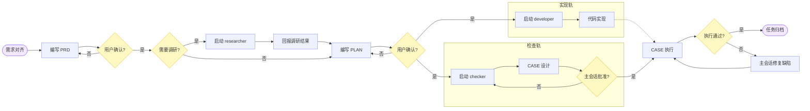

# workloom

workloom 是一套让 AI 按固定流程交付需求的工作方式，它把一次需求变成明确的角色分工和可追溯的过程。

[English](./README.en.md)

## 目录

- [快速上手](#快速上手)
- [workloom 是什么](#workloom-是什么)
- [角色设计](#角色设计)
- [角色协作](#角色协作)
- [工作流程](#工作流程)
- [配置文件](#配置文件)
- [可主动调用的 Skill](#可主动调用的-skill)

## 快速上手

### 前置条件

workloom 以插件形式运行在 DeepSeek Harness 里，开始之前，先确认你的环境里已经装上它。

### 初始化项目

在目标项目的会话里执行 `workloom init`，它会生成或更新 `.workloom/` 目录，里面放着任务、规范和会话记录。

跑 `workloom-doctor` 做一次健康检查，它会检查配置和注入是否正常。

### 走通第一个任务

1. 在会话里描述你想做的事，越具体越好。
2. 主会话会判断这件事值不值得建任务，并给出建议，你确认后才建。
3. 进入需求对齐，主会话按设计树逐轮提问，每轮把所有待定问题一次列全，你逐项回答。
4. 需求没有灰色地带后，主会话给出 PRD 内容请你确认，这是第一道确认。
5. 需要做技术调研时，调研角色把结果写成文件。
6. 主会话准备计划，评审角色审一遍，然后给你 PLAN 内容确认，这是第二道确认。
7. 你确认后任务进入执行，实现角色写代码，检查角色设计检查项并执行检查。
8. 检查通过后，主会话提交代码并归档任务。

整个过程里，文件和产物都留在 `.workloom/` 下，会话结束也不会丢。

### 常用入口

- `workloom init`：初始化或更新项目里的 workloom 资产。
- `workloom-doctor`：检查配置与注入的健康状况。
- 需求对齐、配置修改、会话收尾等动作通过 skill 完成，见 [可主动调用的 Skill](#可主动调用的-skill)。

## workloom 是什么

AI 编码里有几个常见问题，需求靠几句话交代，容易理解偏，过程散落在对话里，回头查不到，做完了没有明确依据，很难判断合格不合格。

workloom 针对这三点。

- 先对齐再动手，需求里的每个决定都要明确，才有资格进入实现。
- 过程留痕，需求、计划、调研、检查结果都写成文件，放在项目里。
- 检查有据可依，检查角色按事先写好的检查项逐条验证，并留下证据。

你可以把它理解成给 AI 配了一套交付纪律，它规定谁在什么时候做什么，交出什么东西。

## 角色设计

一次任务由多个角色协作完成，角色分两类：主会话和执行角色。

### 主会话

主会话是编排者，不是实现者，它负责以下事情。

- 判断要不要建任务，管理任务状态。
- 跟用户对齐需求，拿两道内容确认。
- 拉起执行角色，接收结果。
- 提交代码，归档任务。

主会话有两条边界，执行阶段它不自己写实现代码，代码一律由实现角色产出，检查阶段它可以自己修问题，修完让检查角色重新审一遍。

这条边界保证了做事的人和管理的人分开，过程可追溯。

### 五种执行角色

| 角色 | 职责 |
| --- | --- |
| researcher | 技术调研，把发现写成文件，只回传文件路径和一句话摘要。 |
| judger | 计划评审，对照需求和真实代码，找出计划里的问题。 |
| developer | 实现，写代码，改文件。 |
| frontend-developer | 前端实现，只碰前端 UI 文件，后端接口还没好时，用带标注的占位代替。 |
| checker | 检查，先设计检查项，再逐项执行并记录证据。 |

这么切分有三个理由。

1. 职责单一，每个角色只做一类事。
2. 产物写成文件，交接靠文件路径，不靠口头转述。
3. 各角色独立分派，可以按需拉起，互不干扰。

### effort 档位

每个执行角色都有 effort 档位，分 low、medium、high、xhigh、max 五档，它调节角色思考的深度，简单任务用低档，复杂任务用高档，你可以在配置里按角色指定，见 [配置文件](#配置文件)。

### 建议模型配置

不同角色的任务性质不同，模型和思考深度也该区别对待，下面是推荐搭配，可在配置的 `subagent_profiles` 里按角色设置。

| 角色 | 建议模型 | 建议 effort | 侧重 |
| --- | --- | --- | --- |
| researcher | 经济的 flash 类模型 | medium/high | 探索与速度 |
| judger | 旗舰模型 | xhigh/max | 挖掘计划漏洞，提升计划质量 |
| developer | 经济的 flash 类模型 | xhigh/max | 按计划执行 |
| frontend-developer | 经济的 flash 类多模态模型 | xhigh/max | 按计划执行，兼顾视觉理解 |
| checker | 旗舰模型 | xhigh/max | 实现质量与应用场景设计 |

两类角色用旗舰模型，judger 要找出计划里的漏洞，checker 要判断实现质量和场景设计，都需要较强的推理。其余角色用 flash 类模型即可，把速度优势留给探索和执行，前端实现要读设计稿或界面，所以指定多模态模型。

## 角色协作

角色之间不直接对话，主会话居中调度，产物通过文件交接。

### 谁在什么时候出场

- 需求阶段：主会话独自跟用户对齐。
- 调研阶段（可选）：researcher 出场。
- 计划评审：judger 出场。
- 实现阶段：developer 出场，涉及前端 UI 时，frontend-developer 一起出场，各管一部分文件。
- 检查阶段：checker 出场。

### 产物怎么交接

- 调研结果写在任务的 `research/` 目录，一个主题一个文件。
- 计划评审意见写在 `plan-review.md`。
- 检查项写在 `case.md`。
- 检查结果写在 `case-result.md`。

主会话和角色之间只传这些文件的路径，不传全文。

### 三个关键机制

**检查角色的两段式工作。** checker 先用一段会话设计检查项，写完 `case.md`，主会话看完认可后，继续同一段会话执行检查，两段共用一个会话，检查项和执行上下文连在一起。

**失败自动切换。** 某个模型暂时不可用时，系统会自动换下一个模型重试一次，这个切换链可以按角色在配置里指定。

**提交权集中。** 只有主会话能提交代码，执行角色只改工作区文件，不碰 git 提交，分派默认在后台进行，主会话不等待，继续做别的事。

## 工作流程

一次完整任务走十个阶段，实现和检查两条轨并行推进，用户确认和检查结果都带回退，下面的图给出全貌。



### 第一阶段：计划

1.0 建任务，你描述想做的事，主会话判断是否值得建任务，改动很小、风险很低、几步就能完成时，主会话建议直接改，不建任务，建任务前一定先问你。

1.1 需求对齐，主会话用一棵设计树逐轮提问，覆盖目标、范围、约束、验收、UI 和测试优先级、关键决定、边界情况，每轮把所有待定问题一次列全，结论写进 `prd.md`。需求没有灰色地带后，主会话请你确认 PRD 内容，这是第一道确认，也是实现前的硬门槛。

1.2 调研，可选，需要查代码或技术资料时，researcher 出场，结果写进 `research/`。

1.3 配上下文，主会话把相关的规范和调研文件填进 `implement.jsonl` 和 `check.jsonl`，两份清单只放当前阶段真正要用的东西。

1.4 评计划并启动，主会话写好 `plan.md`，judger 先审一遍，主会话处理完评审意见后，把 PLAN 内容给你确认，这是第二道确认，你确认后，任务进入执行。

### 第二阶段：执行

实现和设计检查项并行推进，两条轨都准备好后，进入检查。

2.1 实现，developer 写代码，涉及前端 UI 的任务，frontend-developer 负责前端文件，主会话在这个阶段不自己写实现代码。

2.2 设计检查项，checker 读需求、计划和规范，写出 `case.md`，每条验收标准至少对应一个检查项，每个改动文件至少对应一个静态审查项。

2.3 执行检查，checker 按 `case.md` 逐项执行，记录实际动作和证据，写进 `case-result.md`，检查还统计改动代码的增量覆盖率，覆盖率不达标时，会给出逐文件原因，由主会话判断放行还是返工。

2.4 提交，检查通过后，主会话提交代码，分支合并也由主会话完成。

### 第三阶段：收尾

3.1 归档，任务完成后归档，工作区一并清理，容器任务会等所有子任务完成后再归档。

### 两道内容确认

整个流程只有两道固定确认：1.1 的 PRD 内容确认，1.4 的 PLAN 内容确认，两道都过了才能开工。

autonomy 三档决定这两道确认要不要自动记录，manual 档全部由你确认，semi 档只自动记录 PLAN，auto 档两道都自动记录，并留下审计记录。

### 任务拆分

一个任务里有三件以上能独立交付的东西时，主会话会建议拆成子任务，拆分前一定先问你，子任务各自走完整流程，容器任务最后做整体验收和归档。

### 定制工作流指引

工作流分两层，状态机是固定的，阶段、步骤和流转都随包分发，项目改不了，每步的自然语言指引则有默认值，项目可以覆盖。

覆盖文件是 `.workloom/workflow.override.md`，可选，放在项目根目录，它只改每个步骤怎么做，比如调整措辞、补充团队约定、强调某个检查点，不改状态机本身，阶段顺序和流转规则不受影响。

团队可以用它让指引更贴合自己的习惯，同时不动流程结构。

内置的 workflow 契约在 [`packages/core/resources/workflow/workflow.md`](packages/core/resources/workflow/workflow.md)，里面列出全部状态、步骤 id 和各自的默认指引，写覆盖前可以先对照它。

文件用 Markdown 写，靠标签和标题认出要覆盖哪段，只有两种块。

- 状态指引块用一对 `[workflow-state:状态名]` 标签包住正文，覆盖对应状态注入的指引，状态名只能用内置的 `no_task`、`planning`、`in_progress`、`completed`。
- 步骤正文块用 `#### 步骤id 原样标题` 起头，下面写新正文，覆盖对应步骤怎么做，步骤 id 必须是内置的，比如 `1.1`、`2.3`，标题沿用内置的不改。

只写你想改的块，其余部分保留内置内容。引入内置以外的状态名或步骤 id 会报错。`[workflow-norms]` 是契约级规范，overlay 改不了。

下面是一个例子，只改规划状态的指引和 2.3 检查步骤的正文。

```markdown
[workflow-state:planning]
先核对需求里的每条验收标准是否可判定，有疑问先问用户。
[/workflow-state:planning]

#### 2.3 执行检查
按 case.md 顺序执行，每条都记录实际动作和证据，覆盖率单独统计。
```

## 配置文件

workloom 的配置分三层，从全局到本机依次覆盖。

### 三层文件

- `$HOME/.workloom/config.json`：全局层，对这台机器上的所有项目生效。
- `.workloom/config.json`：项目层，团队共享，通常入库。
- `.workloom/config.local.json`：本机层，只对当前项目的当前机器生效，不入库。

加载顺序是全局 → 项目 → 本机，后一层覆盖前一层，每层还可以用 `.js` 文件，它是工厂函数，每层只能保留一种形式，json 或 js 二选一。

全局层只接受项目无关的字段，也就是 `subagent_profiles`、`archive_auto_commit`、`prompt_injection`、`executor`，把 `packages`、`hooks`、`worktree`、`coverage` 放进全局层会报错，这些字段只能写在项目层。

### 八个字段

配置字段用下划线命名，加载时会转成运行时需要的写法。

| 字段 | 用途 |
| --- | --- |
| `packages` | 项目里有哪些包，各自路径和工作区准备命令。 |
| `worktree` | 工作区开关、分支命名模板、清理方式。 |
| `hooks` | 任务生命周期钩子，分建任务、启动、收尾、归档四个时机。 |
| `subagent_profiles` | 按主模型匹配，给每个角色设模型、effort 和失败切换链。 |
| `prompt_injection` | 提示词跳过关键词。 |
| `executor` | 执行角色的并发上限。 |
| `archive_auto_commit` | 任务归档时是否自动提交。 |
| `coverage` | 覆盖率门槛和语言配置。 |

`subagent_profiles` 跟角色设计直接相关，它按主模型匹配，给每个角色指定模型和 effort，模型访问失败时的切换链也在这里配。

`coverage.threshold` 默认 90，检查要求增量覆盖率严格大于它，`coverage.languages` 给语言指定报告格式和生成命令。

### 怎么改配置

改配置走 `workloom-config-edit` skill，按五步来。

1. 读现状，读原始文件和合并后的配置，认出每个要改的字段来自哪一层。
2. 提方案，把字段和值以 diff 展示，并核对白名单，白名单之外的字段直接拒绝。
3. 等你确认，方案有改动就重新展示并再确认一次。
4. 备份后写入，只改约定的字段，其余字节保持不变，原子写入。
5. 跑 `workloom-doctor` 验证，有问题就恢复备份。

这里有个坑要提醒，加载器会静默忽略白名单之外的顶层字段，写错了也不会报错，所以第二步的核对不能省。

### 和工作流覆盖的区别

`.workloom/workflow.override.md` 改的是流程步骤的指引，见 [定制工作流指引](#定制工作流指引)，配置文件管的是项目和角色参数，两者不要混。

## 可主动调用的 Skill

除了流程自动加载的能力，下面四个 skill 你可以在会话里主动调用。

| Skill | 什么时候用 | 做什么 |
| --- | --- | --- |
| `workloom-packages-scan` | 想扫一下项目包结构 | 给出 packages 候选和工作区准备命令，顺带探测语言栈。 |
| `workloom-config-edit` | 想改配置字段 | 按五步纪律改配置，避免写错字段。 |
| `workloom-finish` | 会话要结束 | 检查脏文件、归档任务、把工作提交和簿记提交分开。 |
| `workloom-update-spec` | 想沉淀团队规范 | 维护 `.workloom/spec/` 下的规范条目。 |

调用方式很简单，直接说触发语，比如"扫一下包结构""配置 config.local.json""finish"，或者点名 skill。

有一件事要说明，检查项设计、任务续接、计划迁移这些动作走的是工作流契约，没有单独的 skill。
